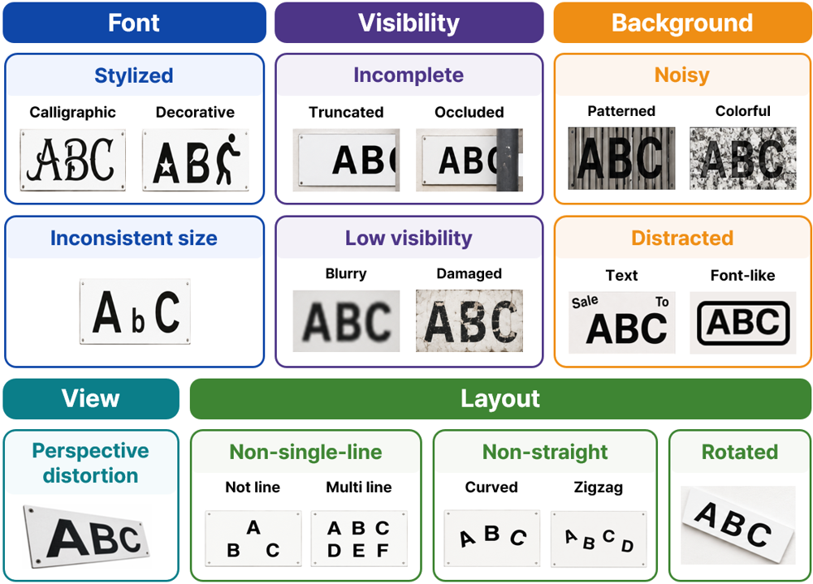
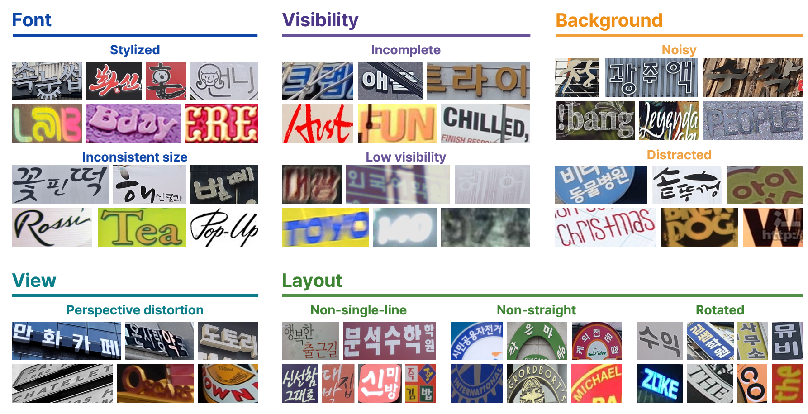

# An Atomic Multi-Tag Taxonomy for Fine-Grained Diagnosis of Scene Text Recognition Models

MyoungHun Han, Jin-Hyuk Hong · WACV 2027

 

Official annotations of the paper ["An Atomic Multi-Tag Taxonomy for Fine-Grained Diagnosis of Scene Text Recognition Models"](#citation). Accepted to **WACV 2027**. The proceedings link is not available yet.





This repository provides atomic multi-tag annotations for **K-STR-Bench** and **Union14M**. Each text crop may contain multiple visual challenge tags, enabling fine-grained analysis of recognition performance under individual and co-occurring challenges. `image_path` is relative to the folder that contains the CSV.

The release is on Hugging Face: [hoonisone/AtomicTags](https://huggingface.co/datasets/hoonisone/AtomicTags).

## Release format

Each split is one CSV and its image folders. This is not an LMDB release. On Hugging Face, each image folder is stored as `text_images.tar`, and the CSV stays beside that archive so the dataset viewer can open it. Extracting the archive recreates a `text_images` folder next to it.

One crop can have several tags. A folder or archive per tag would store that file many times. Images are stored once. All tags for a crop are columns in the CSV, so a subset is a filter on that table.

```text
K_STR_Bench/
├── text.v1.0.csv
├── GIST_Signboard/text_images.tar
└── KAIST_Corrected/text_images.tar
Union14M_Benchmark/
├── text.v1.0.csv
└── text_images.tar
Union14M_General/
├── text_v.1.0.csv
└── text_images.tar
```


## How to use

Download the dataset from Hugging Face, then extract each `text_images.tar`. The CSV files are already unpacked. `image_path` is relative to the folder that contains the CSV. This repository does not distribute the inclusive and exclusive label files. Create them from the CSV after the images are extracted.

```bash
git clone https://github.com/hoonisone/AtomicTags.git
cd AtomicTags
pip install -U huggingface_hub
hf download hoonisone/AtomicTags --repo-type dataset --local-dir data
python prepare.py --dataset-dir data --pipeline extract_images
python prepare.py --dataset-dir data --pipeline make_tag_labels
```

`./K_STR_Bench/labels/inclusive/stylized.txt`

```text
0/gist_7_4.jpg	이글
0/gist_7_5.jpg	피플
```

`./K_STR_Bench/labels/inclusive/stylized.jsonl`

```json
{"filename":"0/gist_7_4.jpg","text":"이글","width":87,"height":74}
{"filename":"0/gist_7_5.jpg","text":"피플","width":104,"height":202}
```


## License

Source code in this repository is under the [MIT License](LICENSE). That license does not cover the images or the annotations. The Atomic Tag annotations are under [CC BY 4.0](https://creativecommons.org/licenses/by/4.0/).

These files do not share one license. Union14M-Benchmark and Union14M-General are not separate licenses. An image keeps the license of the Union14M dataset it came from. Names and terms below follow the [Union14M source table](https://github.com/Mountchicken/Union14M/blob/main/docs/source_dataset.md). Unknown means that table does not state a license.


| Source      | Subset             | License / terms                                     |
| ----------- | ------------------ | --------------------------------------------------- |
| K-STR-Bench | GIST_Signboard     | CC BY 4.0                                           |
| K-STR-Bench | KAIST_Corrected    | CC BY-SA 3.0                                        |
| K-STR-Bench | AIHub_Standardized | Not included. Not redistributed; AIHub Terms of Use |
| Union14M    | KAIST              | CC BY-SA 3.0                                        |
| Union14M    | NEOCR              | CC BY-NC-SA 4.0                                     |
| Union14M    | Uber-Text          | Unknown                                             |
| Union14M    | RCTW               | Unknown                                             |
| Union14M    | IIIT-ILST          | CC BY 4.0                                           |
| Union14M    | MTWI               | CC BY-NC 4.0                                        |
| Union14M    | COCOTextV2         | CC BY 4.0                                           |
| Union14M    | LSVT               | Unknown                                             |
| Union14M    | MLT19              | CC BY-NC 4.0                                        |
| Union14M    | ReCTS              | Unknown                                             |
| Union14M    | ArT                | Unknown                                             |
| Union14M    | IntelOCR           | Apache License 2.0                                  |
| Union14M    | TextOCR            | CC BY 4.0                                           |
| Union14M    | HierText           | CC BY-SA 4.0                                        |


## Data Sources

**K-STR-Bench.** A challenge-aware benchmark for Korean scene text recognition. [GitHub](https://github.com/hoonisone/K-STR-Bench) | [Hugging Face](https://huggingface.co/datasets/hoonisone/K-STR-Bench). The split here is `K_STR_Bench`, from **GIST_Signboard** and **KAIST_Corrected**. **AIHub_Standardized** is part of K-STR-Bench and is not included. The K-STR-Bench release includes every crop and the columns `is_only_korean` and `is_illegible` for filtering. This release is already filtered: `text.v1.0.csv` and the image folders contain only crops where `is_only_korean` is true and `is_illegible` is false.

**Union14M.** A scene text recognition dataset collected from 14 public datasets (Jiang et al., ICCV 2023). [GitHub](https://github.com/Mountchicken/Union14M). Union14M-L and Union14M-Benchmark are released from that repository. The splits here are `Union14M_Benchmark` and `Union14M_General`. We annotate 7,888 samples from the six challenge-specific subsets of Union14M-Benchmark other than Incomplete, along with 9,994 randomly sampled images from its General subset. Each CSV and its image folder already contain only the crops in this release. Tag columns in these tables are separate from the original Union14M annotations.

## Statistics

**Inclusive** counts crops where that tag is true, including crops with other true tags. **Exclusive** counts crops whose only true tag is that tag.


| Tag                    | K-STR-Bench | Union14M-General | Union14M-Benchmark |           |           |     |
| ---------------------- | ----------- | ---------------- | ------------------ | --------- | --------- | --- |
| Inclusive              | Exclusive   | Inclusive        | Exclusive          | Inclusive | Exclusive |     |
| Crops                  | 20,086      | 9,994            | 7,888              |           |           |     |
| Stylized               | 2,273       | 821              | 791                | 171       | 1,727     | 311 |
| Inconsistent size      | 602         | 88               | 253                | 25        | 599       | 19  |
| Incomplete             | 767         | 193              | 844                | 133       | 759       | 82  |
| Low visibility         | 1,352       | 550              | 6,984              | 4,743     | 307       | 25  |
| Noisy                  | 2,844       | 1,466            | 696                | 109       | 1,540     | 143 |
| Distracted             | 3,019       | 457              | 880                | 31        | 3,733     | 127 |
| Perspective distortion | 3,268       | 181              | 1,231              | 33        | 676       | 4   |
| Non-single-line        | 118         | 34               | 0                  | 0         | 0         | 0   |
| Non-straight           | 479         | 60               | 155                | 6         | 2,731     | 203 |
| Rotated                | 4,554       | 1,052            | 2,127              | 214       | 4,928     | 536 |


| True tags on a crop | K-STR-Bench | Union14M-General | Union14M-Benchmark |
| ------------------- | ----------- | ---------------- | ------------------ |
| 0                   | 9,889       | 1,389            | 745                |
| 1                   | 4,902       | 5,465            | 1,450              |
| 2                   | 2,560       | 1,685            | 2,671              |
| 3                   | 1,892       | 852              | 2,100              |
| 4                   | 676         | 467              | 738                |
| 5                   | 135         | 115              | 156                |
| 6                   | 27          | 20               | 21                 |
| 7                   | 3           | 1                | 6                  |
| 8                   | 2           | 0                | 1                  |


## Citation

If you use these annotations, please cite:

```bibtex
@inproceedings{atomicmultitag2027,
    title     = {An Atomic Multi-Tag Taxonomy for Fine-Grained Diagnosis of Scene Text Recognition Models},
    author    = {Han, MyoungHun and Hong, Jin-Hyuk},
    booktitle = {Proceedings of the IEEE/CVF Winter Conference on Applications of Computer Vision (WACV)},
    year      = {2027}
}
```

